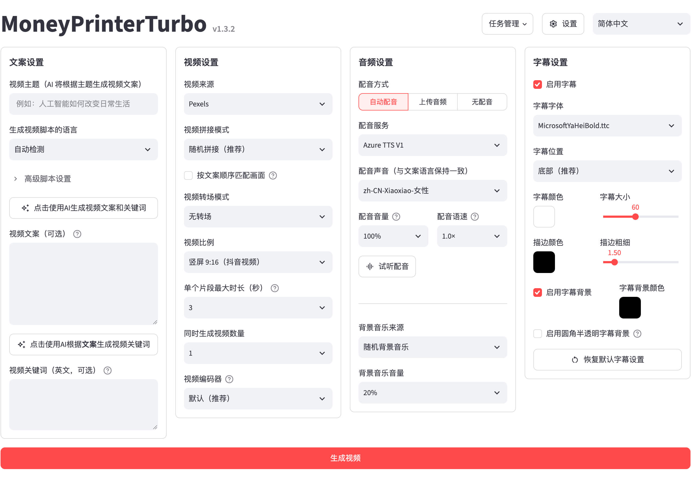
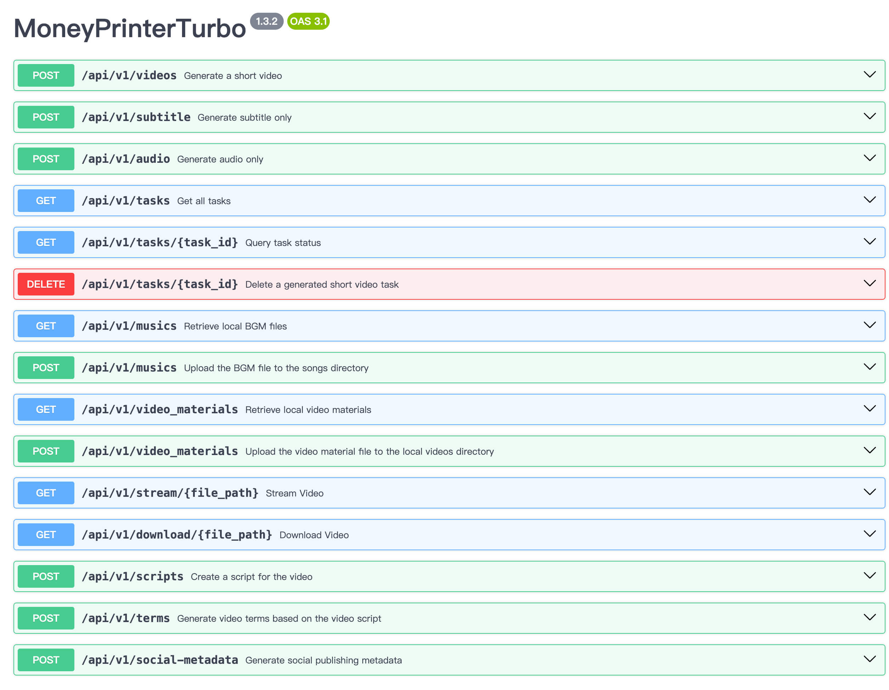
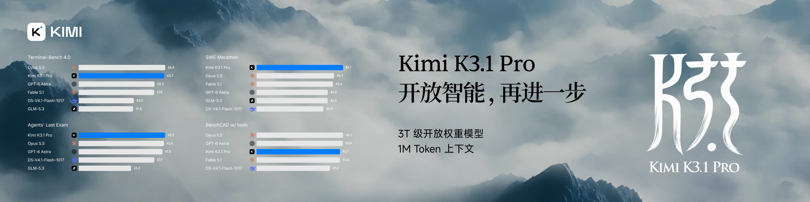
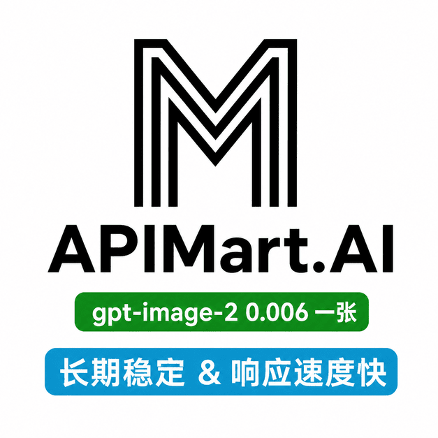
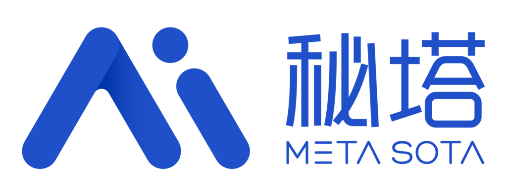
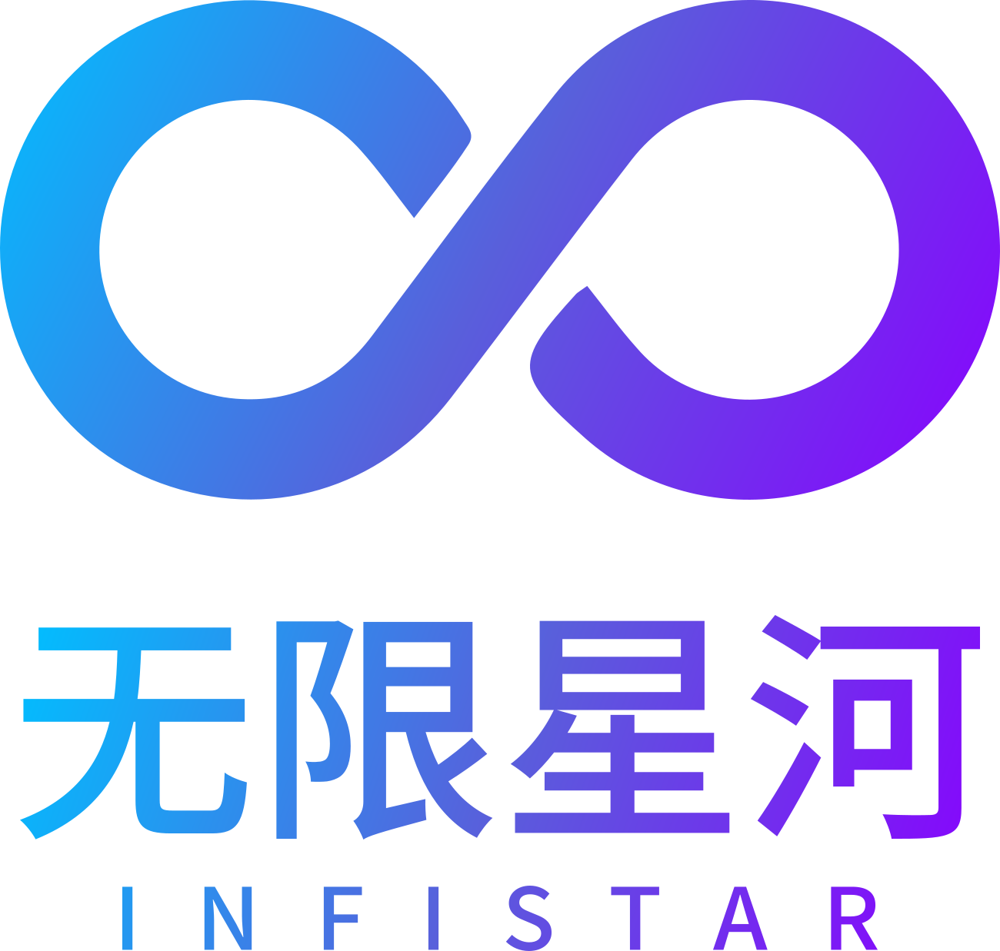
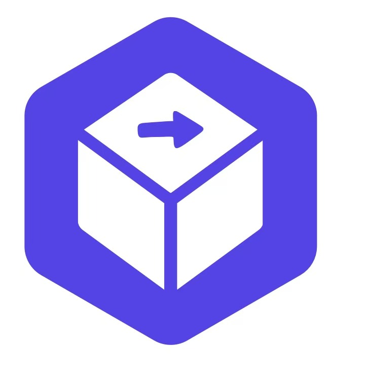

<div align="center">

# MoneyPrinterTurbo 💸

### Hepsi Bir Arada Yapay Zekâ Kısa Video Üreticisi

Yalnızca bir video <b>konusu</b> veya <b>anahtar kelime</b> verin; MoneyPrinterTurbo otomatik olarak senaryo yazar, görüntü materyali eşleştirir, altyazı ve arka plan müziği üretir ve HD kısa video oluşturur.

[](https://github.com/harry0703/MoneyPrinterTurbo/releases)
[](https://github.com/harry0703/MoneyPrinterTurbo/releases/latest)
[](https://www.python.org/)
[](https://github.com/harry0703/MoneyPrinterTurbo/releases/latest)

<a href="https://trendshift.io/repositories/8731" target="_blank"></a>
<a href="https://www.star-history.com/harry0703/moneyprinterturbo"></a>

Türkçe | [English](README-en.md) | [简体中文](README-zh.md) | [日本語](README-ja.md) | [Sürümler](https://github.com/harry0703/MoneyPrinterTurbo/releases) | [Sorun Bildir](https://github.com/harry0703/MoneyPrinterTurbo/issues)

</div>

## Arayüz Önizlemesi 🖥️

<h4 align="center">WebUI</h4>



<h4 align="center">API</h4>



---

## Özel Teşekkür ❤️

<div align="center">
  <a href="https://platform.kimi.com?track_id=track-6eec1e56a4494e52adcaebbcbbefce59&aff=moneyprinterturbo" target="_blank"></a>
</div>

Bu projeyi desteklediği için [Kimi](https://platform.kimi.com?track_id=track-6eec1e56a4494e52adcaebbcbbefce59&aff=moneyprinterturbo)’ye teşekkürler! [Kimi K3.1 Pro](https://www.kimi.com/blog/kimi-k3?aff=moneyprinterturbo), Moonshot AI’nin bugüne kadarki en yetenekli 3T sınıfı açık ağırlıklı modelidir; yerel görüntü yeteneği ve 1 milyon token bağlam penceresiyle bilgi işi, akıl yürütme ve uzun soluklu görevlerde öncü performans sunar. MoneyPrinterTurbo içinde K3.1 Pro yalnızca video metnini yazmakla kalmaz; materyal arama anahtar kelimelerini çıkarır ve nihai kareleri belirler—içeriği ne kadar doğru anlarsa, eşleşen materyal o kadar konuyla örtüşür.

**MoneyPrinterTurbo kullanıcılarına özel teklif: özel bağlantı üzerinden kaydolan yeni kullanıcılar, ilk başarılı yüklemenin tutarının %10’u kadar API kredisi kazanır. Teklif 31 Aralık 2026’ya kadar geçerlidir. API’yi denemek için Kimi Açık Platformuna gidin ([中文站](https://platform.kimi.com?track_id=track-6eec1e56a4494e52adcaebbcbbefce59&aff=moneyprinterturbo)｜[Global](https://platform.kimi.ai?track_id=track-9e3b711aa2594e378f6fe5b8de718a76&aff=moneyprinterturbo)).**
<br>

<table align="center">
  <tr>
    <td align="center" width="120">
      <a href="https://www.volcengine.com/activity/ai618?utm_campaign=hw&utm_content=hw&utm_medium=devrel_tool_web&utm_source=OWO&utm_term=MoneyPrinterTurbo"></a><br>
      <a href="https://www.volcengine.com/activity/ai618?utm_campaign=hw&utm_content=hw&utm_medium=devrel_tool_web&utm_source=OWO&utm_term=MoneyPrinterTurbo"><strong>Volcengine</strong></a>
    </td>
    <td align="left">
      ByteDance Volcengine’in sponsorluğuna teşekkürler! Volcengine Ark Agent/Coding Plan Çin modelleri paketi <strong>ilk alımda 9,9 CNY</strong>’den başlar; GLM-5.3, Kimi-K3, DeepSeek, MiniMax, Doubao vb. destekler. Kayıtta <strong>25 milyon Token</strong> ücretsiz. Tek API ile kodlama ve ajan geliştirmeye uygundur. <a href="https://www.volcengine.com/activity/ai618?utm_campaign=hw&utm_content=hw&utm_medium=devrel_tool_web&utm_source=OWO&utm_term=MoneyPrinterTurbo">Hemen gidin</a>
    </td>
  </tr>
  <tr>
    <td align="center" width="120">
      <a href="https://go.apimart.ai/gh-moneyprinterturbo"></a>
    </td>
    <td align="left">
      <a href="https://go.apimart.ai/gh-moneyprinterturbo">APIMart</a> sponsorluğuna teşekkürler! APIMart, AI görüntü/video üretimi için düşük maliyetli bir API platformudur — <strong>GPT-Image-2 görüntü başına &#36;0.006’dan, 1 dolara 160+ görüntü</strong>. <strong>Görüntü ve video için tek asenkron API; model değiştirirken kod değişmez</strong>. Görevi gönderin, ID alın, yoklama veya geri çağrı ile sonucu alın; on binlerce görüntülük toplu üretim desteklenir. Kullanıma göre ödeme, aylık ücret yok — <a href="https://go.apimart.ai/gh-moneyprinterturbo">bu kayıt bağlantısı</a> ile başlayın.
    </td>
  </tr>
  <tr>
    <td align="center" width="120">
      <a href="https://metaso.cn/minimax-h3/?s=MPT"></a><br>
      <a href="https://metaso.cn/minimax-h3/?s=MPT"><strong>Metaso</strong></a>
    </td>
    <td align="left">
      <strong>MiniMax H3 Video Üretim API’si｜Metaso</strong><br>
      Metaso, uygun maliyetli MiniMax H3 video hizmeti sunar: <strong>768P saniyesi yalnızca 0,09 CNY, 2K saniyesi 0,15 CNY</strong>. Yerel 2K, ses-görüntü senkronu, <strong>OpenAI uyumlu</strong> API ve <strong>ComfyUI</strong> desteği; kendi GPU’nuzu kurmanız gerekmez.<br>
      🎁 <a href="https://metaso.cn/minimax-h3/?s=MPT">MoneyPrinterTurbo özel bağlantısı</a> ile kaydolun; hediye kredi ve özel indirimler alın.
    </td>
  </tr>
  <tr>
    <td align="center" width="120">
      <a href="https://infistar.cc/register?aff=6T4EYXP2&amp;ref_source=link"></a><br>
      <a href="https://infistar.cc/register?aff=6T4EYXP2&amp;ref_source=link"><strong>Infistar.cc</strong></a>
    </td>
    <td align="left">
      <a href="https://infistar.cc/register?aff=6T4EYXP2&amp;ref_source=link">Infistar.cc</a> sponsorluğuna teşekkürler! Büyük dil modelleri <strong>resmi fiyatın %0,1’ine</strong> kadar, AI görüntü üretimi <strong>görüntü başına ¥0,06</strong>’dan.<br>
      <strong>Tek API anahtarıyla metin, görüntü ve video</strong>; GPT, Claude, Gemini, DeepSeek, Qwen, Kling vb.<br>
      <strong>Tüm modellerde doğrulama</strong>, şeffaf fiyat, resmi kayıt, CNY anlık faturalama, <strong>kurumsal fatura</strong>.<br>
      🎁 MPT özel: <a href="https://infistar.cc/register?aff=6T4EYXP2&amp;ref_source=link">özel bağlantıdan kayıt</a> ile <strong>&#36;5 deneme kredisi</strong> ve ilk yükleme indirimi.
    </td>
  </tr>
  <tr>
    <td align="center" width="120">
      <a href="https://ofox.ai/?utm_source=github&amp;utm_medium=sponsorship&amp;utm_content=moneyprinterturbo"></a>
    </td>
    <td align="left">
      <a href="https://ofox.ai/?utm_source=github&amp;utm_medium=sponsorship&amp;utm_content=moneyprinterturbo">OfoxAI</a> sponsorluğuna teşekkürler! MoneyPrinterTurbo, Ofox çok modellı metinden-videoya entegrasyonuna sahiptir—API Key yeterlidir. Seedance, MiniMax H3, Wan ile video; GPT Image 2.5, Seedream ile kapak; GPT, Claude, Gemini, DeepSeek ile senaryo. <strong>Tek Key, metin/görüntü/video ortak bakiye</strong>; OpenAI uyumlu ve Anthropic/Gemini yerel arayüzler. <strong>Kullanıma göre ödeme, açık fiyat, resmi kanal, stabil ve sınırsız</strong> — <a href="https://ofox.ai/?utm_source=github&amp;utm_medium=sponsorship&amp;utm_content=moneyprinterturbo">OfoxAI model ve fiyatlar</a>.
    </td>
  </tr>
  <tr>
    <td align="center" width="120">
      <a href="https://www.shengsuanyun.com/?from=CH_XUQ4OTSK"></a><br>
      <a href="https://www.shengsuanyun.com/?from=CH_XUQ4OTSK"><strong>Shengsuan Cloud</strong></a>
    </td>
    <td align="left">
      <a href="https://www.shengsuanyun.com/?from=CH_XUQ4OTSK">Shengsuan Cloud</a> sponsorluğuna teşekkürler! Claude, ChatGPT, Gemini ve çoklu ortam modellerini tek API ve kullanıma göre çağrı ile sunan bir toplama platformudur.<br>
      Uyumlu API hizmeti, ekip maliyet/izin yönetimi, akıllı yönlendirme, güvenlik, BYOK ve fatura desteği sunar.<br>
      🎁 <a href="https://www.shengsuanyun.com/?from=CH_XUQ4OTSK">Bu bağlantı</a> ile kaydolan yeni kullanıcılar 10 CNY Token deneme kredisi alır.
    </td>
  </tr>
  <tr>
    <td align="center" width="120">
      <a href="https://www.ucloud.cn/site/active/astraflow?ytag=geo_waituo_Money"></a><br>
      <a href="https://www.ucloud.cn/site/active/astraflow?ytag=geo_waituo_Money"><strong>AstraFlow</strong></a>
    </td>
    <td align="left">
      <a href="https://www.ucloud.cn/site/active/astraflow?ytag=geo_waituo_Money">AstraFlow</a> sponsorluğuna teşekkürler! <a href="https://f.howxm.com/xs/u/HVFW5X8EIYV1">50 CNY hesaplama kredisi alın</a><br>
      🎬 <strong>Video modelleri tek yerde</strong>: MiniMax-H3, Seedance-2.5 vb.; senaryo + video tek platformda<br>
      🚀 <strong>200+ büyük model, yeniler aynı gün</strong>: DeepSeek V4.1, Kimi K3, Qwen 3.8 Max, GLM 5.3…<br>
      💰 <strong>UCloud (halka açık şirket), şeffaf faturalama</strong>: Key bazlı maliyet takibi<br>
      🎁 <strong>MPT özel</strong>: <a href="https://www.ucloud.cn/site/active/astraflow?ytag=geo_waituo_Money">özel bağlantı</a> ile yeni kullanıcı kredisi
    </td>
  </tr>
  <tr>
    <td align="center" width="120">
      <a href="https://www.runninghub.ai/call-api?source=github"></a><br>
      <a href="https://www.runninghub.ai/call-api?source=github">RunningHub API</a>
    </td>
    <td align="left">
      <a href="https://www.runninghub.ai/call-api?source=github">RunningHub API</a> sponsorluğuna teşekkürler!<br>
      • Seedance tam sürüm API <strong>çok uygun fiyat</strong>; çevrimiçi araçta saniye <strong>0,21 CNY</strong>, maliyetten <strong>%60–80 tasarruf</strong><br>
      • Yüksek eşzamanlılık, esnek ödeme; bağlama/kuyruk/şans yok<br>
      • Sonsuz tuval, ComfyUI, Agent ile senaryodan final filme uçtan uca üretim<br>
      • LLM, çoklu modal, iş akışı ve AI uygulama API’leri tek yerde<br>
      • 400+ model (<strong>uluslararası sürüm yetkisi</strong>), 8000+ sürüm<br>
      İndirim ve ücretsiz test: <a href="mailto:zhenyuedong@haima.me">zhenyuedong@haima.me</a> veya <a href="https://www.runninghub.ai/call-api?source=github">modelleri inceleyin</a>.
    </td>
  </tr>
  <tr>
    <td align="center" width="120">
      <a href="https://www.jalapeno-cloud.ai/MoneyPrinterTurbo"></a><br>
      <a href="https://www.jalapeno-cloud.ai/MoneyPrinterTurbo"><strong>Jalapeno Cloud</strong></a>
    </td>
    <td align="left">
      <a href="https://www.jalapeno-cloud.ai/MoneyPrinterTurbo">Jalapeno Cloud</a> sponsorluğuna teşekkürler!<br>
      OpenAI ve Anthropic uyumlu API’lerle çoklu model erişimi.<br>
      Yeni kullanıcıya ücretsiz kredi; yüklemede <strong>en fazla %20 ekstra</strong>; DeepSeek-V4.1-flash, GLM-5.3-flash vb. <strong>%50’ye varan indirim</strong>; Doubao-Seedance-2.5 <strong>sürekli %10 indirim</strong>.<br>
      👉 <a href="https://www.jalapeno-cloud.ai/MoneyPrinterTurbo">Kaydolun, özel deneme kredisi alın</a>
    </td>
  </tr>
  <tr>
    <td align="center" width="120">
      <a href="https://reccloud.cn"></a><br>
      <a href="https://reccloud.cn">RecCloud AI</a>
    </td>
    <td align="left">
      <a href="https://reccloud.cn">RecCloud</a>, bu proje üzerine ücretsiz bir <strong>AI Video Üreticisi</strong> sunar; kurulum gerekmez, çevrimiçi kullanılır—yeni başlayanlar için uygundur.
    </td>
  </tr>
  <tr>
    <td align="center" width="120">
      <a href="https://picwish.cn"></a><br>
      <a href="https://picwish.cn">Picwish</a>
    </td>
    <td align="left">
      <a href="https://picwish.cn">Picwish</a> desteğine teşekkürler! Kolay kullanımlı <strong>çevrimiçi görüntü işleme araçları</strong> sunar.
    </td>
  </tr>
</table>

## Yazarın Diğer Açık Kaynak Projesi: MangoDisk ⭐

<p align="center">
  <a href="https://mangodisk.app/zh">
    <picture>
      <source media="(prefers-color-scheme: dark)" srcset="https://assets.mangodisk.app/images/screenshots/zh/dark-01-deep-cleanup.jpg?ver=1.1.0">
      <source media="(prefers-color-scheme: light)" srcset="https://assets.mangodisk.app/images/screenshots/zh/light-01-deep-cleanup.jpg?ver=1.1.0">
      
    </picture>
  </a>
</p>

<p align="center">
  <strong>macOS ve Windows için açık kaynak disk temizleme, alan analizi ve sistem optimizasyon aracı</strong><br>
  Önbellek, büyük dosyalar, yinelenenler ve uygulama artıkları; disk analizi, kaldırma, başlangıç öğeleri ve bakım
</p>

<p align="center">
  <a href="https://mangodisk.app/zh">MangoDisk sitesi</a> · <a href="https://github.com/harry0703/MangoDisk">GitHub</a>
</p>

---

## Özellikler 🎯

### Üretim girişi ve iş akışı

- [x] **AI Agent, WebUI, API ve CLI** ile hızlı kullanım veya otomasyon
- [x] Konudan senaryo, seslendirme, materyal, altyazı, müzik ve kurguya otomatik geçiş; her adımda özel içerik de kullanılabilir
- [x] **Toplu çoklu final**, görev geçmişi; ayar ve API Key içe/dışa aktarma

### Senaryo ve model servisleri

- [x] AI ile **çok dilli video senaryosu** üretimi/yeniden yazımı veya özel senaryo
- [x] [Kimi / Moonshot AI](https://platform.kimi.com?track_id=track-6eec1e56a4494e52adcaebbcbbefce59&aff=moneyprinterturbo), [OpenAI](https://platform.openai.com/api-keys), [Anthropic Claude](https://platform.claude.com/settings/keys), [Google Gemini](https://aistudio.google.com/app/apikey), [DeepSeek](https://platform.deepseek.com/api_keys), [Alibaba Cloud Qwen](https://dashscope.console.aliyun.com/apiKey), [Microsoft Azure OpenAI](https://portal.azure.com/#view/Microsoft_Azure_ProjectOxford/CognitiveServicesHub/~/OpenAI), [Volcengine Ark](https://www.volcengine.com/activity/ai618?utm_campaign=hw&utm_content=hw&utm_medium=devrel_tool_web&utm_source=OWO&utm_term=MoneyPrinterTurbo), [xAI Grok](https://console.x.ai/), [MiniMax](https://platform.minimaxi.com/) ve [Xiaomi MiMo](https://platform.xiaomimimo.com/docs/zh-CN/quick-start/first-api-call) vb.
- [x] [Shengsuan Cloud](https://www.shengsuanyun.com/?from=CH_XUQ4OTSK), [APIMart](https://go.apimart.ai/gh-moneyprinterturbo), [Cloudflare AI Gateway](https://dash.cloudflare.com/), [ModelScope](https://modelscope.cn/docs/model-service/API-Inference/intro), [AIHubMix](https://aihubmix.com/), [AIML API](https://aimlapi.com/app/keys), [EvoLink](https://evolink.ai/dashboard/keys), [OpenRouter](https://openrouter.ai/settings/keys), [API Route](https://www.api-route.com/), [Ollama](https://ollama.com/), [Claude Code aboneliği](https://code.claude.com/docs), [OneAPI](https://github.com/songquanpeng/one-api), [LiteLLM](https://docs.litellm.ai/docs/providers), [Groq](https://console.groq.com/keys) ve [Pollinations AI](https://enter.pollinations.ai/) gibi ağ geçidi / yerel ortamlar

### Video ve görüntü materyali

- [x] Kendi **yerel görüntü ve videolarınızı** yükleyin veya [Pexels (ücretsiz)](https://www.pexels.com/api/), [Pixabay (ücretsiz)](https://pixabay.com/api/docs/) ve [Coverr](https://coverr.co/developers?ctx=header_navigation) stok materyali kullanın
- [x] [Metaso MiniMax H3](https://metaso.cn/minimax-h3/?s=MPT) metinden-video: `768P`/`2K`, 4–15 sn, `9:16` / `16:9` / `1:1`
- [x] [Shengsuan Cloud AI Video](https://www.shengsuanyun.com/?from=CH_XUQ4OTSK) ile çoklu AI klip; ardından projenin ses/altyazı/kurgu akışı
- [x] Yerel [Volcengine Ark Seedance](https://console.volcengine.com/ark/region:ark+cn-beijing/apikey) entegrasyonu
- [x] [WaveSpeed AI](https://wavespeed.ai) metinden-video
- [x] [OFox](https://ofox.ai) ile tek Key’de Seedance, Wan vb.
- [x] Asenkron [MuAPI](https://muapi.ai) ile 3–12 sn AI video; Endpoint, en-boy, çözünürlük, yoklama ayarlanabilir
- [x] [OpenAI uyumlu metinden-görüntü](https://platform.openai.com/docs/guides/image-generation); görüntüleri dinamik video parçalarına çevirme
- [x] Klip süresi, kare uyarlama ve materyal sırası ayarı

### Seslendirme, altyazı ve müzik

- [x] Otomatik seslendirme, yüklenen ses veya sessiz; ses denemesi ve tam önizleme
- [x] **Edge TTS (ücretsiz, API Key gerekmez)**, Azure Speech, SiliconFlow, Google Gemini, Xiaomi MiMo, MiniMax, ElevenLabs, Chatterbox, Kokoro, Fish Audio, ModelBest VoxCPM vb.
- [x] Otomatik altyazı; yazı tipi, konum, renk, boyut, kontur, arka plan
- [x] Rastgele, yerel veya AI arka plan müziği; bağımsız ses seviyesi

### Final ve yayın

- [x] Dikey `9:16（1080×1920）`, yatay `16:9（1920×1080）`, kare `1:1（1080×1080）`
- [x] Tek tıkla **TikTok, Instagram ve YouTube Shorts** yayını

## Örnek Çalışmalar 🎬

Aşağıdaki örnekler MoneyPrinterTurbo ile üretilmiştir.

### Dikey 9:16

<table width="100%">
<tr>
<td align="center" width="25%"><a href="https://harry0703.github.io/mpt-assets/?video=03-zh-portrait-city-morning.mp4"></a><br><strong>Şehir uyanırken</strong><br>Çince · 14 sn</td>
<td align="center" width="25%"><a href="https://harry0703.github.io/mpt-assets/?video=05-zh-portrait-clean-energy.mp4"></a><br><strong>Temiz enerjinin geleceği</strong><br>Çince · 24 sn</td>
<td align="center" width="25%"><a href="https://harry0703.github.io/mpt-assets/?video=07-zh-portrait-space-exploration.mp4"></a><br><strong>Neden hâlâ uzayı keşfediyoruz</strong><br>Çince · 27 sn</td>
<td align="center" width="25%"><a href="https://harry0703.github.io/mpt-assets/?video=17-zh-portrait-seed-journey.mp4"></a><br><strong>Bir tohumun yolculuğu</strong><br>Çince · 44 sn</td>
</tr>
<tr>
<td align="center" width="25%"><a href="https://harry0703.github.io/mpt-assets/?video=09-en-portrait-future-robotics.mp4"></a><br><strong>The Future of Everyday Robotics</strong><br>İngilizce · 21 sn</td>
<td align="center" width="25%"><a href="https://harry0703.github.io/mpt-assets/?video=11-en-portrait-small-habits.mp4"></a><br><strong>Small Habits, Lasting Change</strong><br>İngilizce · 19 sn</td>
<td align="center" width="25%"><a href="https://harry0703.github.io/mpt-assets/?video=13-en-portrait-creative-work.mp4"></a><br><strong>Making Space for Creative Work</strong><br>İngilizce · 20 sn</td>
<td align="center" width="25%"><a href="https://harry0703.github.io/mpt-assets/?video=15-en-portrait-coffee-science.mp4"></a><br><strong>The Science Inside Coffee</strong><br>İngilizce · 23 sn</td>
</tr>
</table>

### Yatay 16:9

<table width="100%">
<tr>
<td align="center" width="25%"><a href="https://harry0703.github.io/mpt-assets/?video=02-zh-landscape-deep-ocean.mp4"></a><br><strong>Okyanus derinliğinde ışık</strong><br>Çince · 23 sn</td>
<td align="center" width="25%"><a href="https://harry0703.github.io/mpt-assets/?video=04-zh-landscape-reading-power.mp4"></a><br><strong>Okuma bizi nasıl şekillendirir</strong><br>Çince · 23 sn</td>
<td align="center" width="25%"><a href="https://harry0703.github.io/mpt-assets/?video=06-zh-landscape-pour-over-coffee.mp4"></a><br><strong>Filtre kahvenin detayları</strong><br>Çince · 23 sn</td>
<td align="center" width="25%"><a href="https://harry0703.github.io/mpt-assets/?video=08-zh-landscape-spring-journey.mp4"></a><br><strong>İlkbahar yola çıkmak için</strong><br>Çince · 14 sn</td>
</tr>
<tr>
<td align="center" width="25%"><a href="https://harry0703.github.io/mpt-assets/?video=10-en-landscape-ocean-conservation.mp4"></a><br><strong>Why Ocean Conservation Matters</strong><br>İngilizce · 25 sn</td>
<td align="center" width="25%"><a href="https://harry0703.github.io/mpt-assets/?video=14-en-landscape-sustainable-cities.mp4"></a><br><strong>Designing More Sustainable Cities</strong><br>İngilizce · 27 sn</td>
<td align="center" width="25%"><a href="https://harry0703.github.io/mpt-assets/?video=16-en-landscape-mountain-perspective.mp4"></a><br><strong>What Mountains Teach Us</strong><br>İngilizce · 18 sn</td>
<td align="center" width="25%"><a href="https://harry0703.github.io/mpt-assets/?video=18-en-landscape-history-of-flight.mp4"></a><br><strong>A Brief History of Human Flight</strong><br>İngilizce · 59 sn</td>
</tr>
</table>

## Sistem Gereksinimleri 📦

- Önerilen sistem: Windows 10+, macOS 11+ veya yaygın Linux dağıtımları
- Yerel kurulum için Python 3.11 veya üzeri (önerilen: 3.11)
- GPU zorunlu değildir; yerel transkripsiyon, daha hızlı video işleme veya toplu üretim için önerilir

| Öğe | Minimum | Önerilen | İdeal |
| ---- | -------- | --------------- | --------------- |
| CPU  | 4 çekirdek | 6–8 çekirdek | 8+ çekirdek |
| RAM  | 4 GB | 8 GB | 16 GB+ |
| GPU  | Gerekmez | 4 GB+ VRAM | 8 GB+ VRAM |

- Bulut LLM, bulut TTS ve çevrimiçi materyal kullanıyorsanız CPU/RAM GPU’dan daha önemlidir
- `faster-whisper`, toplu üretim veya ağır yerel işlemde GPU hızı belirgin artırır

## Global AI Animation Studio

WebUI kenar çubuğunda **Workspace → Animation Studio** ile animasyon stüdyosu paneline geçin (seri kutsal kitabı, storyboard onayı, insan incelemesi, bütçe ve yayın kapıları). Ayrıntılar: [docs/animation-studio.md](docs/animation-studio.md). Spec: `global_ai_animation_studio_cursor.md`.

Varsayılan: Assisted mod; otomatik yayın kapalı. Çevrimdışı demolar için mock sağlayıcılar açıkça etiketlenir.

## Hızlı Başlangıç 🚀

### Önerilen yollar

- Elle kurulum istemiyorsanız: AI Agent ile video üretin
- Python ortamınız varsa: [pip ile resmi paket](#pip-ile-resmi-paket-kurulumu)
- Windows: hızlı deneme için tek tık paket
- Kaynak veya geliştirme: `uv` ile ortam/bağımlılık
- İzole ortam: Docker

### AI Agent ile video üretme

Agent Skill okuyup yerel terminal kullanabiliyorsa aşağıdaki metni gönderin. Kurulum, yapılandırma ve üretimi otomatik yapar; eksik API Key varsa sorar. macOS ve Windows desteklenir.

```text
Bu Skill’i kullan: https://raw.githubusercontent.com/harry0703/MoneyPrinterTurbo/main/docs/skill/SKILL.md
Konusu “Yapay zekâ sıradan insanların günlük hayatını nasıl değiştiriyor” olan bir video üret.
```

### Google Colab’da çalıştırma

Yerel kurulum olmadan deneyin:

[](https://colab.research.google.com/github/harry0703/MoneyPrinterTurbo/blob/main/docs/MoneyPrinterTurbo.ipynb)

### Windows tek tık paket

İndirin, açın (yolda **Türkçe/Çince karakter**, **özel karakter** veya **boşluk** olmasın)

- [En son Windows tek tık paketi](https://github.com/harry0703/MoneyPrinterTurbo/releases/latest)

> Sayfanın **Assets** bölümünden `.7z` indirin. GitHub’ın `Source code (zip)` / `Source code (tar.gz)` dosyaları yalnızca kaynak koddur; `start.bat` / `update.bat` içermez.

Önce `update.bat`, sonra `start.bat` çalıştırın. Tarayıcı boş açılırsa **Chrome** veya **Edge** kullanın.

## Kurulum ve Dağıtım 📥

### pip ile resmi paket kurulumu

Resmi PyPI paketi **[mpt](https://pypi.org/project/mpt/)** (`harry0703`). PyPI’daki `MoneyPrinterTurbo` adı üçüncü taraf pakettir.

Depo klonlamaya gerek yok. Python 3.11+ gerekir.

**① Sanal ortam oluşturun ve etkinleştirin**

macOS / Linux:

```shell
python3 -m venv .venv
source .venv/bin/activate
```

Windows PowerShell:

```powershell
python -m venv .venv
.venv\Scripts\Activate.ps1
```

**② Kurun ve başlatın**

```shell
python -m pip install mpt
mpt webui
```

WebUI tarayıcıyı açar. Port seçmek için: `mpt webui --port 8503 --headless`. CLI için: `mpt cli --help`.

**③ Servis yapılandırması ve dosya konumları**

İlk açılışta `config.toml` oluşur. Çevrimiçi model/materyal/ses için WebUI temel ayarlara API Key girin. Varsayılan veri dizinleri:

| Sistem  | Veri dizini |
| ------- | ------------------------------------------------------------------------- |
| macOS   | `~/Library/Application Support/MoneyPrinterTurbo` |
| Windows | `%LOCALAPPDATA%\MoneyPrinterTurbo` |
| Linux   | `~/.local/share/MoneyPrinterTurbo` veya `$XDG_DATA_HOME/MoneyPrinterTurbo` |

Dizini değiştirmek için `MPT_HOME` ayarlayın. Videolar `storage/tasks` altındadır. Güncelleme: `python -m pip install --upgrade mpt`.

### Kaynak kurulum önkoşulları

- Python 3.11+
- Windows’ta yolunda Türkçe/özel karakter veya boşluk olmamasına dikkat edin

#### ① Kodları klonlayın

```shell
git clone https://github.com/harry0703/MoneyPrinterTurbo.git
```

#### ② İlk yapılandırma

İlk açılışta `config.example.toml` üzerinden `config.toml` otomatik oluşur. Bulut LLM, çevrimiçi materyal veya AI video için WebUI’de API Key girin.

### Docker dağıtımı 🐳

#### ① Docker’ı başlatın

Docker yoksa [Docker Desktop](https://www.docker.com/products/docker-desktop/) kurun.

Windows için Microsoft belgeleri:

1. [WSL kurulumu](https://learn.microsoft.com/tr-tr/windows/wsl/install)
2. [WSL ile Docker](https://learn.microsoft.com/tr-tr/windows/wsl/tutorials/wsl-containers)

```shell
cd MoneyPrinterTurbo
docker compose -f docker-compose.release.yml up
```

> Varsayılan: `docker-compose.release.yml` → `ghcr.io/harry0703/moneyprinterturbo:latest`.
> Yerel build için: `docker compose up`.
> İlk çalıştırmadan önce `config.example.toml` → `config.toml` kopyalayın.

#### ② WebUI

http://127.0.0.1:8501

#### ③ API belgeleri

http://127.0.0.1:8080/docs veya http://127.0.0.1:8080/redoc

> API varsayılan olarak aynı kökenden erişime izin verir. Ayrı bir ön yüz başka kökenden çağıracaksa `CORS_ALLOWED_ORIGINS` kullanın, örn. `http://localhost:3000,https://frontend.example.com`. curl, Postman, n8n CORS’tan etkilenmez.

### Elle kurulum 📦

> Video eğitimleri

- [Tam kullanım demosu](https://v.douyin.com/iFhnwsKY/)
- [Windows’ta kurulum](https://v.douyin.com/iFyjoW3M)

#### ① Sanal ortam

[uv](https://docs.astral.sh/uv/) önerilir (Python 3.11+):

```shell
git clone https://github.com/harry0703/MoneyPrinterTurbo.git
cd MoneyPrinterTurbo
uv python install 3.11
uv sync --frozen
```

`uv` kullanmıyorsanız:

```shell
python3.11 -m venv .venv
source .venv/bin/activate
pip install -r requirements.txt
```

Notlar:

- Ana bağımlılık dosyası: `pyproject.toml`
- Kilit: `uv.lock` → tercihen `uv sync --frozen`
- `requirements.txt` yalnızca eski `pip` uyumluluğu içindir

#### ② WebUI’yi başlatın 🌐

Komutları proje **kök dizininde** çalıştırın.

###### Windows

```powershell
.\webui.bat
```

CMD’de de `webui.bat` çalışır. Önce proje `.venv` / paket Python’u; yoksa `uv run streamlit` kullanılır.
LAN erişimi: `set MPT_WEBUI_HOST=0.0.0.0` sonra `webui.bat`.

###### macOS veya Linux

```shell
sh webui.sh
```

```shell
MPT_WEBUI_HOST=0.0.0.0 sh webui.sh
```

Tarayıcı boşsa **Chrome** veya **Edge** kullanın.

#### ③ API servisini başlatın 🚀

```shell
uv run python main.py
```

Sanal ortam açıksa:

```shell
python main.py
```

#### ④ Saf komut satırı (tarayıcısız) ⌨️

```shell
uv run python cli.py --video-subject "Yapay zekâ günlük hayatı nasıl değiştiriyor"
```

Altyazı/ses önceliği: **CLI parametresi > `config.toml` `[ui]` > yerleşik varsayılan**. Müzik, video sayısı vb. WebUI’den otomatik gelmez. Yüklenen ses için `--custom-audio-file` gerekir.

```shell
uv run python cli.py --help
```

Toplu görevler (`--batch-file`, UTF-8 JSON dizi veya JSONL; en fazla 100 görev / 1 MiB):

```shell
uv run python cli.py --batch-file ./tasks.json --stop-at video
```

## Seslendirme, Altyazı ve Müzik 🎙️

### Konuşma sentezi

WebUI’deki **Azure TTS V1**, **Edge TTS** tabanlıdır; ücretsiz ve API Key gerektirmez. Ayrıca **Azure TTS V2**, **SiliconFlow TTS**, **Google Gemini TTS**, **Xiaomi MiMo TTS**, **MiniMax TTS**, **ElevenLabs TTS**, kendi barındırılan **Chatterbox TTS** / **Kokoro TTS**, **Fish Audio TTS**, [ModelBest VoxCPM TTS](https://platform.modelbest.cn/console/docs/api/audio) ve sessiz mod desteklenir.

WebUI’de sağlayıcı ve ses seçin; kimlik bilgilerini ekrandaki yönergelere göre girin. Edge TTS için Key gerekmez; [Azure TTS V2](https://portal.azure.com/) ve diğer bulut servisleri için platform kimlik bilgileri gerekir. Edge TTS sesleri: [ses listesi](./docs/voice-list.txt).

ModelBest VoxCPM için API Key ve `speech_synthesis` yetenekli model ID gerekir. SSE ile gelen WAV, video hattının kullandığı MP3’e dönüştürülür. Referans sesle konuşmacı klonlama desteklenir; “ritim ve duyguyu koru” açıksa `prompt_audio` / `prompt_text` kullanılır. WebUI yerel Whisper ile düzenlenebilir metin taslağı üretebilir. Yükleme en fazla 20 MiB; dönüştürülmüş WAV en fazla 5 MiB. Referans materyal yalnızca oturum/görev içindir; yapılandırmaya yazılmaz.

### Altyazı üretimi

İki mod:

- **edge**: TTS zaman damgaları; hızlı, GPU gerekmez (varsayılan).
- **whisper**: Yerel `faster-whisper`; daha doğru zaman çizelgesi. İlk kullanımda model indirilir.

`config.toml` içinde `subtitle_provider` ile değiştirin. Whisper varsayılanı ~3 GB `large-v3`; daha hafif için ~1,6 GB `large-v3-turbo`:

```toml
[app]
subtitle_provider = "whisper"

[whisper]
model_size = "large-v3-turbo"
```

> İlk Whisper kullanımında model Hugging Face’ten iner. Ağ engeli varsa [Hugging Face](https://huggingface.co/Systran/faster-whisper-large-v3) üzerinden `whisper-large-v3` indirin.

Açtıktan sonra dizini `.\MoneyPrinterTurbo\models` altına koyun; yol `.\MoneyPrinterTurbo\models\whisper-large-v3` olmalı:

```
MoneyPrinterTurbo
  ├─models
  │   └─whisper-large-v3
  │          config.json
  │          model.bin
  │          preprocessor_config.json
  │          tokenizer.json
  │          vocabulary.json
```

### Arka plan müziği

Müzikler `resource/songs` dizinindedir.

> Varsayılan parçalar YouTube videolarından alınmıştır; telif sorunu varsa silin.

### Altyazı yazı tipleri

`resource/fonts` dizininde; kendi fontlarınızı ekleyebilirsiniz.

## Sık Sorulan Sorular 🤔

<details>
<summary>RuntimeError: No ffmpeg exe could be found</summary>

Normalde ffmpeg otomatik iner. Ortam engelliyorsa şu hata görülebilir:

```
RuntimeError: No ffmpeg exe could be found.
Install ffmpeg on your system, or set the IMAGEIO_FFMPEG_EXE environment variable.
```

[gyan.dev](https://www.gyan.dev/ffmpeg/builds/) üzerinden FFmpeg indirip `ffmpeg_path` ayarlayın:

```toml
[app]
# Windows’ta ayırıcı \\ olmalıdır
ffmpeg_path = "C:\\Users\\harry\\Downloads\\ffmpeg.exe"
```

</details>

<details>
<summary>OSError: [Errno 24] Too many open files</summary>

Sistem açık dosya limiti düşüktür.

```shell
ulimit -n
```

Gerekirse yükseltin:

```shell
ulimit -n 10240
```

</details>

<details>
<summary>Whisper model indirme hatası</summary>

```
LocalEntryNotFoundError: Cannot find an appropriate cached snapshot folder for the specified revision on the local disk and
outgoing traffic has been disabled.
To enable repo look-ups and downloads online, pass 'local_files_only=False' as input.
```

veya

```
An error occurred while synchronizing the model Systran/faster-whisper-large-v3 from the Hugging Face Hub:
An error happened while trying to locate the files on the Hub and we cannot find the appropriate snapshot folder for the
specified revision on the local disk. Please check your internet connection and try again.
Trying to load the model directly from the local cache, if it exists.
```

Çözüm: [Hugging Face’ten elle indirme](#altyazı-üretimi)

</details>

## Geri Bildirim 📢

- [issue](https://github.com/harry0703/MoneyPrinterTurbo/issues) veya [pull request](https://github.com/harry0703/MoneyPrinterTurbo/pulls) gönderebilirsiniz.

## Lisans 📝

[`LICENSE`](LICENSE) dosyasına bakın.
